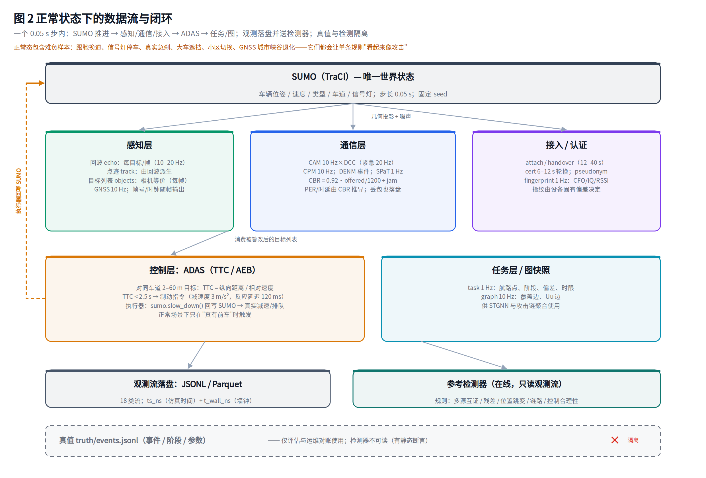
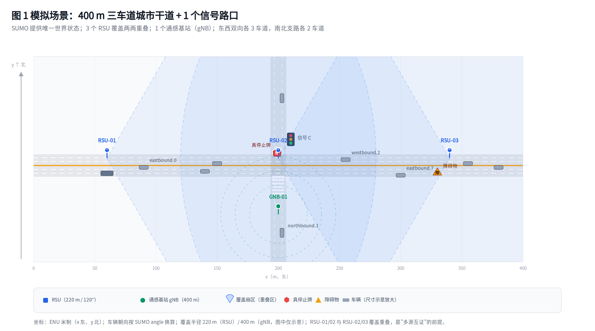
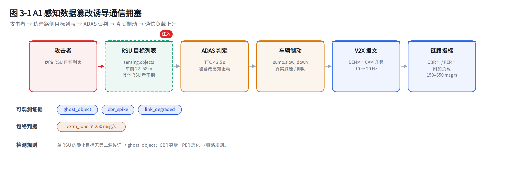
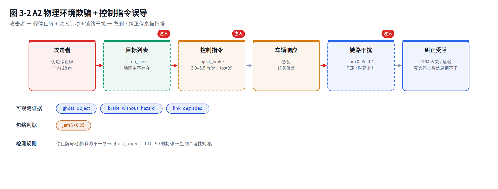
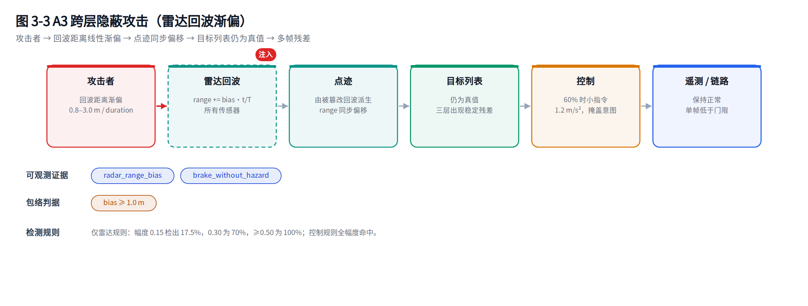
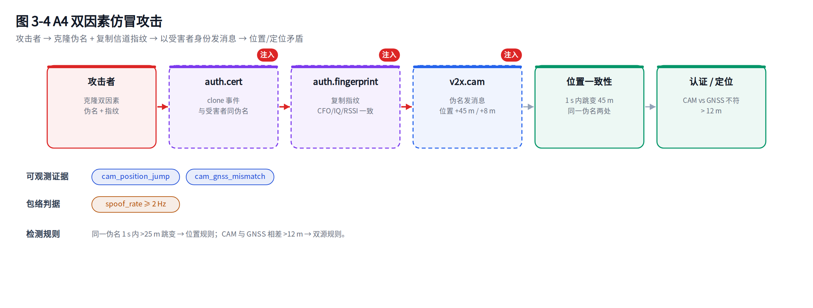
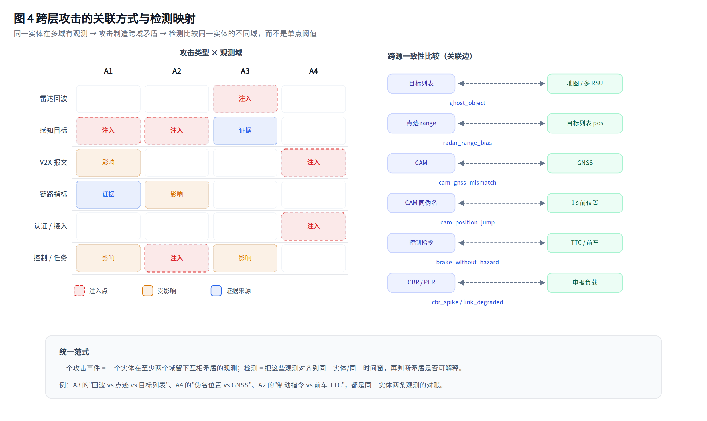

# 实现说明：项目结构、数据生成、攻击注入与检测

本文按代码实际实现说明四件事：项目怎么组织、各类数据怎么生成、攻击怎么定义与注入、检测怎么工作。
文中路径均可直接对照仓库，行号以当前版本为准。

全文配 7 张示意图：场景布局（图 1）、正常流程（图 2）、四类攻击（图 3-1～3-4）、跨层关联（图 4）。

> v0.3.0 实施进展：新增语义级 CoreLayer（AMF/SMF/UPF/UDM/AUSF），Uu 改为 gNB 覆盖驱动；记录 schema 升级为 `isacsim.record/2`。核心网设计见 [10-通信层语义级拓展详细设计](10-通信层语义级拓展详细设计.md)。
图片源文件与生成脚本在 [`figs/`](../figs/)，可改 `figs/gen_figs.py` 后重新生成。

---

## 1 项目结构

### 1.1 目录

```
ISAC_SIM/
├── isacsim/                     # 主包（约 5000 行 Python）
│   ├── __init__.py              # 版本、T0_NS、schema 常量
│   ├── config.py                # 场景数据类 + YAML 载入/校验
│   ├── sumo_env.py              # 定位并初始化 SUMO（pip wheel）
│   ├── cli.py / __main__.py     # info/bench/preflight/run/batch/eval/export/web
│   ├── core/
│   │   ├── engine.py            # 仿真主循环、生命周期、快照
│   │   ├── context.py           # SimContext.emit + HookBus（攻击注入点）
│   │   ├── records.py           # Record、JSONL/Parquet/Tee Sink
│   │   ├── stats.py             # 记录量/攻击/告警/时延统计
│   │   ├── preflight.py         # 硬件信息与算力预检
│   │   ├── ids.py               # trace/span/chain 关联 ID
│   │   └── rng.py               # 按种子+流名派生确定性随机源
│   ├── world/
│   │   ├── sumo_backend.py      # SUMO 进程、TraCI 订阅、增删车、制动执行器
│   │   └── geometry.py          # 坐标/朝向/视场/遮挡
│   ├── layers/
│   │   ├── sensing.py           # 雷达回波、点迹、目标列表、帧、GNSS
│   │   ├── v2x.py               # CAM/CPM/DENM/SPaT、CBR/PER/DCC
│   │   ├── uu.py                # gNB 覆盖驱动的附着/切换/会话
│   │   ├── core/                # 语义核心网（AMF/SMF/UPF/UDM/AUSF + CoreBus）
│   │   ├── health.py            # 节点健康度阈值/评分
│   │   ├── auth.py              # 证书/假名/信道指纹
│   │   ├── control.py           # ADAS（TTC/AEB）与执行器
│   │   ├── task.py              # 航路/阶段/偏差
│   │   └── edge.py              # 实体图快照
│   ├── attacks/
│   │   ├── base.py              # AttackSpec / AttackInstance / 工具
│   │   ├── campaigns.py         # A1–A4 四类跨层剧本
│   │   ├── primitives.py        # 8 类单体原语
│   │   └── scheduler.py         # 运行时调度（启动/推进/结束/计数）
│   ├── truth/model.py           # 真值事件模型与落盘
│   ├── detect/reference.py      # 参考检测器（只读观测流）
│   ├── detect/chain.py          # 告警级链构建器
│   ├── eval/metrics.py          # 告警聚类、事件匹配、Wilson、报表
│   ├── eval/chain_metrics.py    # 链级节点/根因/阶段指标
│   ├── batch/runner.py          # 多进程数据集生成
│   ├── io/pcapng.py             # 最小 pcapng 写入器
│   ├── io/adapters/nidd.py      # D0–D3 / CAM pcapng / labels 导出
│   └── web/
│       ├── session.py           # 单会话管理（起停/暂停/复位/攻击下发）
│       ├── api.py               # FastAPI + SSE
│       └── static/              # 原生 HTML/CSS/JS + Canvas
├── assets/                      # 路网 XML、net.net.xml、车流路由
├── configs/scenes/arterial.yaml # 场景配置示例
├── schemas/                     # record / truth JSON Schema
├── scripts/                     # build_net / web / gen_dataset / accept / ui_smoke
├── figs/                        # 示意图（SVG 源 + PNG + 生成脚本）
├── tests/                       # 65 项测试
└── docs/                        # 00–10
```

### 1.2 模块职责与规模

| 模块 | 行数 | 职责 |
|---|---:|---|
| `core/` | 882 | 主循环、记录、上下文、统计、预检、RNG |
| `world/` | 382 | SUMO 后端与几何 |
| `layers/` | 778 | 六类观测层 + 图 |
| `attacks/` | 725 | 规格、剧本、原语、调度 |
| `truth/` | 99 | 真值模型与落盘 |
| `detect/` | 202 | 参考检测器 |
| `eval/` | 170 | 事件级评估 |
| `batch/` | 95 | 多进程生成 |
| `io/` | 214 | pcapng 与 NIDD 适配 |
| `web/` | 291 | FastAPI 会话与接口 |
| `tests/` | 301 | 单元/集成/冒烟 |

### 1.3 运行时对象与生命周期

```
SessionManager（web/session.py）
  └── Simulation（core/engine.py）
        ├── SumoBackend         # 一个 SUMO 子进程 + 一条 TraCI 连接
        ├── SensingLayer / V2XLayer / UuLayer / CoreLayer
        ├── PlatformLayer / AuthLayer / ControlLayer / TaskLayer / EdgeLayer
        ├── AttackScheduler     # 持有 AttackInstance 列表
        ├── TruthStore          # out/<run>/truth/events.jsonl
        ├── Sink                # JSONL / Parquet / Null
        └── ReferenceDetector   # 可选，在线只读记录
```

会话状态机：`idle → starting → running ⇄ paused → stopping → stopped`，异常进入 `error`。
Web 的仿真跑在后台线程（`web/session.py`），REST 只发命令，SSE 只读快照。

### 1.4 单步执行顺序

`Simulation.step_once()`（`isacsim/core/engine.py:107`）：

```
1. sumo.step()                      # SUMO 推进一个步长（默认 0.05 s）
2. 读取订阅结果 → vehicles           # 位姿/速度/类型/车道
3. scheduler.tick(ctx)              # 攻击开始/推进/结束；设置 extras（负载、干扰）
4. sensing.tick(ctx)                # 回波 → 点迹 → 目标列表 → 帧 → GNSS
5. v2x.tick(ctx)                    # CAM/CPM/DENM/SPaT + CBR/PER/DCC
6. uu.tick / core.tick / auth.tick  # 接入、核心网、证书/指纹
7. control.tick(ctx)                # ADAS 消费被篡改的目标列表 → 制动指令
8. task.tick / edge.tick            # 任务状态；实体图
9. stats 更新 sim_time / vehicles
```

**顺序是刻意设计的**：攻击调度在感知之前，因此本步注册的钩子、设置的附加负载立即生效；控制层在感知之后，因此它消费的永远是"被篡改后"的目标列表。



*图 2　正常状态下的数据流与闭环：SUMO 推进 → 感知/通信/接入 → ADAS → 任务/图；
观测落盘并送检测器，真值与检测隔离。橙色回路是"制动回写"。*

---

## 2 数据生成

### 2.1 统一记录格式

所有数据都写成同一种记录（`isacsim/core/records.py:17`）：

```json
{
  "schema": "isacsim.record/2",
  "run_id": "web-arterial-42-181900",
  "stream": "v2x.cam",
  "ts_ns": 1730842800100000000,
  "t_wall_ns": 15098132453994,
  "source": "east_truck.0",
  "entity": "veh:east_truck.0",
  "payload": { }
}
```

| 字段 | 含义 |
|---|---|
| `ts_ns` | 仿真时间（`T0_NS + t`），跨源对齐用 |
| `t_wall_ns` | `time.monotonic_ns()`，只用于时延测量 |
| `source` | 产生者：传感器 ID / 车辆 ID / `MEC` / `attacker:*` |
| `entity` | 统一实体：`veh:` `rsu:` `gnb:` `obj:` `net:` `attacker:`，v0.3.0 起增加 `ue:` `amf:` `smf:` `upf:` 等 |
| `payload` | 各流自己的字段 |

两条时间轴分离，是"仿真时间推进"与"墙钟时延测量"互不干扰的关键。

### 2.2 世界状态从哪来



*图 1　模拟场景：400 m 三车道干道 + 1 个信号路口；3 个 RSU 覆盖两两重叠，1 个通感基站；
东西双向各 3 车道，南北支路各 2 车道。车辆尺寸为示意放大，覆盖半径 220 m（gNB 400 m）。*

唯一世界状态来自 SUMO，经 `SumoBackend`（`isacsim/world/sumo_backend.py`）读取：

| 步骤 | 实现 |
|---|---|
| 启动 | `traci.start([sumo, -n net, -r route, --seed, --step-length 0.05])`，并保存 `_process` |
| 订阅 | 每辆车订阅 `VAR_POSITION/ANGLE/SPEED/TYPE/LENGTH/WIDTH/LANE_ID` |
| 读取 | `getAllSubscriptionResults()`；为空时退回逐车查询 |
| 转换 | `VehicleState`：`x/y`、`angle`（北=0 顺时针）、`heading_deg = (90-angle)%360`（东=0 逆时针）、`vx/vy` |
| 执行器 | `slow_down(vid, speed, duration)`、`set_speed`、`add_vehicle`、`remove_vehicle` |

所有传感器、通信、控制数据都是对这份状态的**几何投影 + 噪声 + 事件逻辑**，不另造轨迹。

### 2.3 雷达回波（`sensing.radar.echo`）

实现：`SensingLayer._visible()`（`layers/sensing.py:69`）与 `_emit_frame()`（`:110`）。

**可见性**

```
distance r = hypot(vx - sx, vy - sy)
若 r > range_m          → 不可见
若方位角超出 ±fov/2      → 不可见
若被大车（length ≥ 6 m）遮挡 → 不可见
```

遮挡用"点到线段距离 + 投影参数"判定（`world/geometry.py:point_segment_distance`），只把车长 ≥6 m 的车当遮挡物，避免 O(N²) 全车互查。

**检测概率**

```python
snr   = 32.0 - 0.045 * r + (3.0 if truck else 0.0)   # dB
p_det = 1 / (1 + exp(-(snr - 4.0) / 2))
若 rng.random() > p_det → 本帧丢点
```

**测量噪声**（`layers/sensing.py:125`）

| 量 | 模型 |
|---|---|
| 距离 | `r_meas = r + bias_m + N(0, 0.12 + 0.003r)` |
| 径向速度 | `v_r + N(0, 0.15)` |
| 方位/俯仰 | 几何值（不加噪） |
| 回波信噪比 | `snr + N(0, 0.8)` |
| RCS | 车 9 / 卡车 12 dBsm `+ N(0, 0.6)` |
| 幅度/相位 | `10^(snr/20)`、`U(0, 2π)` |
| 时钟 | `offset_ms + drift_ppm·1e-6·t + N(0, 0.4 ms)` |

**号牌（航迹号）**：每个 `(sensor, vehicle)` 首次出现时分配自增整数，`tracked_age` 每帧 +1。

**数据结构**（实测样本，截断）：

```json
{
  "sensor_id": "RSU-01", "entity": "veh:northbound.0",
  "frame_seq": 0, "target_id": 1,
  "range_m": 165.275, "radial_vel_mps": -7.142,
  "azimuth_deg": -29.343, "elevation_deg": -1.724,
  "rcs_dbsm": 9.07, "snr_db": 23.77,
  "amplitude": 16.836, "phase_rad": 6.139,
  "ts_offset_ms": 0.057
}
```

`frame_seq = round(t · rate_hz)`；RSU 10 Hz、GNB 20 Hz，步长 0.05 s 时分别每 2 步 / 每步出帧。

### 2.4 点迹（`sensing.radar.track`）

点迹**不是**独立生成的，而是从**回波的处理结果**派生（`layers/sensing.py:145` 起）：

```python
final_echo = ctx.emit("sensing.radar.echo", ...)   # 先经过攻击钩子
base = final_echo if final_echo is not None else echo
track.range = base.range + N(0, 0.05)
track.radial_vel = base.radial_vel + N(0, 0.03)
track.pos_x = 真值 x + N(0, 0.15)
```

这一点是 A3 能产生"回波→点迹"传播链的原因：篡改回波距离，点迹随之偏移，而目标列表仍是真值，三者出现矛盾。

点迹额外带 `pos_x/pos_y`（几何位置）与 `confidence`，供检测器把"测距"与"由位置反算的距离"对比。

### 2.5 目标列表（`sensing.objects`）

目标列表由**真值几何 + 分类**直接导出，不经过雷达：

| 来源 | 字段 |
|---|---|
| 可见车辆 | `object_id`（本传感器航迹号）、`cls`、`x/y/z`、`l/w/h`、`vx/vy`、`heading_deg`、`confidence`、`tracked_age`、`occluded=false`、`entity` |
| 场景静态目标 | 停止牌/障碍物，`object_id` 为配置值，`tracked_age=99` |
| 帧头 | `sensor_id`、`coverage_id`、`frame_seq`、`clock_offset_ms`、`source_kind` |

对象位置加 `N(0, 0.15 m)`，速度加 `N(0, 0.1)`，置信度 0.88 附近。

**关键点**：目标列表是"相机/路侧感知"的等价物，因此 A1/A2 的"伪造停止牌/障碍物"注入在这里完成；它和雷达回波是两条独立通道，才可能有"雷达说 30 m、目标列表说 35 m"的矛盾。

### 2.6 帧与 GNSS

| 流 | 频率 | 关键字段 |
|---|---|---|
| `sensing.frame` | 每传感器出帧 | `frame_seq`、`object_count`、`clock_offset_ms`、`drift_ppm` |
| `sensing.gnss` | 10 Hz（全部车辆） | `x/y`、`lat/lon`、`v_east/v_north`、`hdop`、`fix_type`、`num_sats` |

GNSS 噪声：一般 `σ=0.4 m`；距路口 (200, 0) 40 m 内视为城市峡谷，`σ=1.2 m`、`hdop=2.6`、`num_sats=8`。

### 2.7 通信数据（V2X）

实现：`layers/v2x.py`。

**信道模型**（`:36`）

```python
offered = 已装备车辆数 × 10 × dcc_factor + RSU数 × 10 + 攻击附加负载
cbr     = min(0.98, 0.92 × offered / 1200 + jam)
```

- 容量常数 `1200 msg/s`（10 MHz PC5、200–300 B 报文的等效值）；
- **DCC**：`cbr>0.65` 时 `dcc_factor` 每步 −0.1（下限 0.5）；`cbr<0.55` 时每步 +0.05（上限 1.0），带迟滞避免振荡；
- `PER = min(0.95, 0.01 + 0.85·max(0, cbr−0.55)/0.45 + 0.6·jam)`；
- `delay = 2 + 45·cbr³ + delay_bonus` ms。

每条 CAM 按 `PER` 做一次伯努利丢包，**丢包也落盘**（`lost=true`），检测侧可据此做链路质量判断。

**各消息**

| 流 | 频率 | 触发 | 关键字段 |
|---|---|---|---|
| `v2x.cam` | `10·dcc` Hz（紧急 20 Hz） | 每辆已装备车 | `sender_pseudo`、`pseudonym`、`msg_id`、`posx/posy`、`spdx/spdy`、`rate_hz`、`cert_status`、`delay_ms`、`lost`、`cbr` |
| `v2x.cpm` | 10 Hz | 每个 RSU | `object_count`、`objects`（最多 12 个摘要）、`delay_ms`、`lost` |
| `v2x.denm` | 事件驱动 | ADAS 制动 / 攻击伪造 | `cause`、`posx/posy`、`delay_ms`、`lost` |
| `v2x.spat` | 1 Hz | 每个 RSU | `signal_state`（从 SUMO 信号灯读取） |
| `link.metrics` | 10 Hz | MEC | `cbr`、`offered_msgs_s`、`per`、`delay_p50_ms`、`dcc_factor`、`jam` |

"已装备"与"有 ADAS"由 `crc32(vid)` 稳定映射到比例阈值（`layers/common.py`），同一辆车在整个运行中属性不变。

### 2.8 Uu、认证、控制、任务、图

| 流 | 频率 | 生成逻辑 |
|---|---|---|
| `uu.attach` | 进入/离开 gNB 覆盖 | `event=attach/detach`、`gnb_id`、`cell_id`、`rrc_state` |
| `uu.handover` | serving gNB 变化 | `from_gnb/to_gnb`、`from_cell/to_cell`、`interruption_ms` |
| `uu.session` | 0.5 Hz | `gnb_id`、`pdu_session_id`、`5qi`、`latency_ms`、`attached` |
| `auth.cert` | 6–12 s 轮换 | `issue` / `rotate`，假名 `PN-<vid>-<n>` |
| `auth.fingerprint` | 1 Hz | 设备固有指纹 + 小噪声 |
| `control.command` | 事件驱动 | `src/dst/cmd_type/params{decel,ttc}/seq/sign_status/reason` |
| `task.state` | 1 Hz | `task_id/phase/waypoint_idx/deviation_m/deadline_s` |
| `graph.snapshot` | 10 Hz | `nodes[]` + `edges[]`（coverage / radio / n2 / n11 / n4 / n6） |

**核心网（v0.3.0，`layers/core/`）：**

| 流 | 频率 | 生成逻辑 |
|---|---|---|
| `core.nas` | 事件 | 注册请求/鉴权请求/鉴权响应/注册接受/去注册；带 `trace_id/span_id` |
| `core.session` | 事件 | PDU 会话建立/接受/释放；`pdu_session_id`、`ue_ip`、`dnn`、`snssai` |
| `core.qos` | 事件 | QoS flow 创建；`qfi`、`5qi`、`gfbr_kbps`、`mfbr_kbps` |
| `core.handover` | 事件 | serving gNB 变化；`source_gnb`、`target_gnb`、`interruption_ms` |
| `core.upf` | 事件 | flow install/delete；`teid`、`route`、`qfi`、`5qi` |

核心网为语义状态机，不做 NAS/NGAP 编码；详见 [10-通信层语义级拓展详细设计](10-通信层语义级拓展详细设计.md)。

**平台（v0.3.0，`layers/platform/`）：**

| 流 | 频率 | 生成逻辑 |
|---|---|---|
| `app.auth` | 事件 | token 签发/校验/吊销；`token_id`、`scope`、`result`、`reason` |
| `app.ingest` | 消息驱动 | 消费 CPM/DENM/SPaT；`source`、`provenance`、`schema_ok` |
| `app.subscription` | 事件 | 租户订阅/退订；`event_types`、`callback` |
| `app.control` | 事件 | 云控指令；`command_id`、`vehicle_ids`、`token_id`、`result` |
| `app.audit` | 事件 | 审计序列/哈希；`audit_seq`、`prev_hash`、`hash` |

平台控制意图进入 `ctx.extras["layers"]["control"].intents`，由 `ControlLayer` 下一 tick 执行；`v2x.cpm/denm/spat` 在 `V2XLayer` 内进入 `v2x_outbox` 供平台消费。

**信道指纹**（`layers/auth.py:20`）由 `sha256(vid)` 的前几个 4 字节归一化得到：

```python
cfo_ppm     = -3.0 + 6.0·u1
iq_gain_db  = -0.8 + 1.6·u2
iq_phase_deg= -4.0 + 8.0·u3
rssi_base   = -58 - 12·u1
```

每次采样加 `N(0, 0.03/0.02/0.08/1.2)` 的噪声。同一设备稳定、不同设备可分——这是 A4"复制指纹"能被识别的物理基础。

**ADAS**（`layers/control.py`）：

```
对同车道（|横向| ≤ 2.2 m）、纵向 2–60 m 的目标：
  closing = 自车速度 − 目标沿航向速度（下限 0.2）
  TTC     = 纵向距离 / closing
若 TTC < 2.5 s 且距上次指令 >3 s：
  发出制动指令（减速度 3.0 m/s²，TTC 写入 params）
  0.12 s 后通过 sumo.slow_down(vid, v − decel·duration, duration) 执行
```

### 2.9 速率与实测数据量

60 s 默认场景（60 车、3 RSU + 1 gNB）实测：

| 流 | 条数 | 说明 |
|---|---:|---|
| `sensing.radar.echo` | 68,501 | 每个可见目标每帧一条 |
| `sensing.radar.track` | 68,501 | 与回波一一对应 |
| `sensing.gnss` | 30,768 | 10 Hz × 全部车辆 |
| `v2x.cam` | 28,856 | 10 Hz × 已装备车辆 |
| `task.state` | 3,079 | 1 Hz |
| `sensing.objects` / `frame` | 3,000 / 3,000 | 每传感器每帧 |
| `auth.fingerprint` | 2,882 | 1 Hz |
| `v2x.cpm` | 1,797 | 10 Hz × RSU |
| `link.metrics` / `graph.snapshot` | 599 / 599 | 10 Hz |
| `auth.cert` | 391 | 轮换 |
| `v2x.spat` | 177 | 1 Hz × RSU |
| `uu.attach/session/handover` | 125 / 120 / 65 | — |
| `control.command` | 4 | 本场景无攻击时的真实刹车 |
| **合计** | **212,464**（108 MB） | — |

回波+点迹占记录量约 2/3，是性能与磁盘的主要来源。

---

## 3 攻击实现

### 3.1 注入点：HookBus

所有记录都经过 `SimContext.emit()`（`core/context.py:60`）：

```python
payload = self.hooks.apply(stream, payload, self)   # ← 攻击钩子
if payload is None: return None                     # 丢弃整条记录
rec = Record(stream, ts_ns, source, entity, payload)
self.sink.emit(rec)                                 # 落盘
if self.detector: self.detector.on_record(rec)      # 检测
return payload
```

因此：

- 攻击**只能改 payload**（或返回 `None` 丢弃），不能改 SUMO 世界状态；
- 落盘与检测看到的是**同一条**记录（检测器不会拿到"更干净"的版本）；
- 是否落盘由 Sink 决定，注入与存储解耦。

钩子按 `stream` 注册，`HookBus.on/off` 维护列表；剧本结束时撤销。

### 3.2 攻击对象模型与调度

| 类 | 位置 | 作用 |
|---|---|---|
| `AttackSpec` | `attacks/base.py:15` | `type/count/target/amplitude/duration/start/params` |
| `AttackInstance` | `attacks/base.py:96` | 生命周期 `start/tick/stop`、钩子登记、`truth()` |
| `CampaignA1–A4` | `attacks/campaigns.py` | 跨层剧本 |
| `PrimitiveAttack` | `attacks/primitives.py` | 8 类单体原语 |
| `AttackScheduler` | `attacks/scheduler.py` | 下发、按时启动、推进、结束、计数 |

调度规则（`scheduler.py:24`）：

```
submit(spec)：
  for i in 0..count-1:
     start_at = (spec.start 或 "下一步") + i×2.0 s
     实例加入列表
tick(ctx)：
  未开始且 t ≥ start_at → start(ctx)；写入真值；stats 计数
  已开始且 t ≥ t1     → stop(ctx)；撤销钩子
  否则               → inst.tick(ctx)
```

每次 `submit` 生成 `count` 个独立实例，错峰 2 s，因此"数量=3"表示三个可分辨的攻击事件，而不是一条记录重复三次。

### 3.3 真值怎么产生

真值由实例自己声明（`AttackInstance.truth()`），在 **start 时**写入 `truth/events.jsonl`：

```json
{
  "event_id": "EVT-web-...-ATK003",
  "campaign": "A3",
  "official_type": "跨层隐蔽攻击",
  "label": 1,
  "t0": 8.0, "t1": 16.0,
  "nodes": ["veh:westbound.4", "gnb:GNB-01"],
  "domains": ["radar", "control", "perception"],
  "params": {"bias_max_m": 2.34, "victim": "westbound.4", "ramp_s": 8},
  "amplitude": 0.7,
  "envelope": {"in_envelope": true, "criterion": "bias >= 1.0 m"},
  "stages": [{"name": "回波距离渐偏", "t0": 8.0, "t1": 16.0}, ...],
  "causal_chain": ["radar.echo:range_ramp", "radar.track:bias", ...],
  "seed": 11,
  "generator_version": "isacsim-0.3.0"
}
```

`t1` 在 start 时就确定（`t0 + duration`），因此真值文件是"预先声明"的，而不是事后根据检测结果补写。

### 3.4 四类跨层剧本

#### A1 感知篡改诱导通信拥塞（`campaigns.py:38`）

| 阶段 | 代码动作 |
|---|---|
| 选目标 | 稳定哈希选一个 RSU 和一辆车 |
| 伪造目标 | 生成 `n = 1 + round(4a)` 个静止目标（`car`/`obstacle` 交替），位于车前 `22 + 9i` m、横向 `0.4(i%3) − 0.4` |
| 注入 | 钩子只在**该 RSU** 的 `sensing.objects` 追加这些目标 |
| 放大 | 每步把 `extra_load = 150 + 500a` 加到 `v2x_extra_load`；每 0.5 s 伪造一条 `v2x.denm`（`sender=ATK-A1`, `forged=true`） |
| 后果 | ADAS 看到障碍 → TTC 触发 → 真实制动 → DENM/CAM 升频 → CBR 上升、PER 升高 |

真值 `domains = [perception, v2x, control]`；包络判据 `extra_load ≥ 250 msg/s`。



*图 3-1　A1：伪造目标列表 → ADAS 误判 → 真实制动 → CAM 升频/伪造 DENM → CBR 上升。
红色虚线框是注入点（发射器输出侧）。*

更细的逐行代码走读、实测时序与当前实现的差异，见 [A1 攻击实现解析](09-A1攻击实现解析.md)。

#### A2 物理欺骗 + 控制指令误导（`campaigns.py:104`）

| 阶段 | 代码动作 |
|---|---|
| 伪造停止牌 | 车前 28 m 生成 `stop_sign`，注入目标 RSU 的目标列表 |
| 控制误导 | `t0+1 s` 调用 `control.inject_brake(victim, decel=3.0+2.5a, duration=1.8)` |
| 链路干扰 | 每步把 `jam = 0.05 + 0.35a` 加到 `link_jam`，抬高 PER 与时延 |
| 后果 | 车辆急刹；纠正用的 CPM 被延迟/丢失；任务偏差 |

真值 `domains = [perception, control, link]`；包络 `jam ≥ 0.05`。



*图 3-2　A2：三处注入（停止牌、制动指令、链路干扰）叠加，使车辆急刹且纠正信息被拖慢。*

#### A3 跨层隐蔽攻击（`campaigns.py:170`）

| 阶段 | 代码动作 |
|---|---|
| 回波渐偏 | 钩子匹配 `payload.entity == victim`，把 `range_m` 加上 `bias_max·(t−t0)/duration`，`bias_max = 0.8 + 2.2a` |
| 传播 | 点迹由"钩子后的回波"派生，因此点迹同步偏移；目标列表不变 |
| 掩盖 | 时长 60% 处注入一次小幅制动（1.2 m/s²，0.8 s），遥测不变 |
| 后果 | 单帧偏差低于门限；多帧累积后，回波/点迹/目标列表三层出现稳定残差 |

真值 `domains = [radar, control, perception]`；包络 `bias_max ≥ 1.0 m`。



*图 3-3　A3：回波距离线性渐偏 → 点迹同步偏移 → 目标列表仍为真值，
三层残差只在多帧累积后显现；60% 时长处再注入一次小制动。*

#### A4 双因素仿冒（`campaigns.py:230`）

| 阶段 | 代码动作 |
|---|---|
| 选受害者 | 只从**已装备**车辆中选，保证真实 CAM 存在 |
| 克隆标识 | start 时发一条 `auth.cert`（`event=clone`，伪名与受害者相同） |
| 复制指纹 | 读取 `baseline_fingerprint(victim)`，每条伪造记录原样写入 |
| 注入消息 | 按 `spoof_rate = 2 + 18a` Hz 发 CAM：伪名=受害者、位置=真实位置 `+45 m`、`+8 m` |
| 后果 | 同一伪名 1 s 内出现 45 m 位置跳变；CAM 与 GNSS 相差 45 m |

真值 `domains = [auth, v2x]`；包络 `spoof_rate ≥ 2 Hz`。

> v0.3.0 起，A4 真值只声明实际可观测的认证与 V2X 域；早期误写的 `uu:ghost_attach` 已移除（Uu 阶段尚未实现）。



*图 3-4　A4：克隆伪名与指纹，以受害者身份在偏移位置发消息，
制造"同一伪名两处"与"CAM/GNSS 不符"。*

### 3.4.1 扩展剧本（v0.3.0，M3）

| 剧本 | 代码动作 | 关键证据 | 真值域 |
|---|---|---|---|
| A5 | `core.amf.set_overload(True)`；每 0.1 s 发伪 UE 注册；平台 ingest 延迟 +200 ms；t0 下发一次远控制动 | `core.nas` 注册拒绝、`core.session` 失败、`app.ingest` 高时延、`control.command` | uu/core/app/task/control |
| A7 | `core.upf.set_route("dn:EVIL-01")`；伪造 `v2x.cpm` 并注入 `platform.ingest`（provenance=EVIL）；`control.inject_brake` | `core.upf` route_change、`app.ingest` provenance 不符、`v2x.cpm` forged、`control.command` | core/app/v2x/control |
| A9 | 复用平台租户 token；每 0.5 s 批量 `submit_control` 3–8 辆车 | `app.auth`、`app.control` 多车、`control.command`、`app.audit` | app/control/task/v2x |

A5/A7/A9 仍在“发射器输出侧”注入；A7 结束时恢复 UPF 路由，A5 结束时清除 AMF 过载。

### 3.5 单体原语（`attacks/primitives.py`）

| 原语 | 注入位置 | 参数公式 | 记录改动 |
|---|---|---|---|
| `ghost_object` | `sensing.objects` | 车前 26 m | 追加一个 `obstacle` |
| `range_bias` | `sensing.radar.echo` | `1.0 + 3.0a` m | `range_m += bias`（点迹随之） |
| `echo_suppress` | `sensing.radar.echo` | — | 返回 `None`：回波与点迹都不再产生，目标列表仍保留该车 |
| `gnss_spoof` | `sensing.gnss` | `+20+40a` m（x）、`+10 m`（y） | 改 `x/y` |
| `brake_inject` | `control.command` | `t0+0.5s`，`4.0+2.0a` m/s² | 经 `ControlLayer.inject_brake` |
| `jam` | `link.metrics` | `0.1 + 0.4a` | 抬 PER/时延 |
| `denm_flood` | 负载 + `v2x.denm` | `300 + 1200a` msg/s，每 0.2 s 一条 | 伪造 DENM |
| `id_clone` | `v2x.cam` | 每 0.2 s，位置 `+40/+6 m` | 伪名=受害者 |

### 3.6 攻击如何影响车辆运动

攻击本身不直接改 SUMO 世界，但 A1/A2/A3 的制动通过 `ControlLayer` 的**执行器**落地：

```
inject_brake() → _command() → 写 control.command → pending（0.12 s 后）
              → sumo.slow_down(vid, v − decel·duration, duration)
              → SUMO 内真实减速/排队 → 下一帧传感器看到新车速
```

这条链保证"感知注入 → 制动 → 拥堵"是数据推出来的，而不是脚本摆出来的。

### 3.7 一次 A1 的时序

```
t0        scheduler: start → truth 写入；RSU 目标列表出现 3 个静止目标
t0+0.05   sensing: 目标列表含幽灵；点迹/回波正常（雷达没看到）
t0+0.05   control: 受害车 TTC≈2 s → 发 brake 指令
t0+0.17   sumo.slow_down → 减速
t0+0.2    v2x: 该车 DENM；CAM 升频到 20 Hz
t0+0.3    link.metrics: CBR 上升（附加负载 450 msg/s + 升频）
t1        stop：撤销钩子；真值 t1 固定为 t0+duration
```

---

## 4 检测实现

### 4.1 检测是否读取真值？——不读

明确回答：

- 检测入口是 `ReferenceDetector.on_record(record)`（`isacsim/detect/reference.py:64`），
  它接收的参数只有**一条观测记录**，没有 `truth`、没有 `ctx`；
- `SimContext.emit()` 在写盘之后调用检测器，二者拿到同一条记录；
- `isacsim/detect/` 不导入 `isacsim.truth`（`tests/test_detector.py` 有静态断言）；
- 真值只在两处使用：`isacsim/eval/metrics.py` 做**评分**；Web 顶部显示"真值事件数"做**运维对账**（不参与判定）。

所以本项目**不是**"读真值标注冒充检测"。

但需要如实说明：参考检测器与生成器由同一套实现同步开发、在同一批场景上调试，
它不是独立第三方检测器；它的 100% 只对"本环境 + 本包络 + 本次参数"成立。

### 4.2 检测器结构

```
on_record(rec)
  ├─ sensing.objects   → 幽灵目标规则（多 RSU 互证 + 地图先验）
  ├─ sensing.radar.track → 距离残差规则（回波 vs 几何位置）
  ├─ v2x.cam           → 位置跳变规则 + CAM/GNSS 一致性
  ├─ link.metrics      → CBR 突增 + PER 恶化
  ├─ control.command   → 无 TTC 依据的制动
  └─ sensing.gnss      → 更新定位缓存（供 CAM 一致性）
```

每条告警带 `t`、`rule`、`entity`、`detail`、`latency_ms`；同一 `(rule, entity)` 有 1 s 冷却，避免刷屏。

### 4.3 七条规则

| 规则 | 触发条件 | 抑制误报的设计 |
|---|---|---|
| `ghost_object` | 目标 `cls ∈ {stop_sign, obstacle}`；距地图静态目标 >3 m；其他传感器 2.5 m 内无同位置目标；连续 2 帧 | 地图先验 + 多 RSU 互证 + 连续帧 |
| `radar_range_bias` | 点迹 `range_m` 与"传感器到 `pos_x/pos_y` 的几何距离"之差；取最近 5–6 帧、去极值后均值 >1.5 m；连续 3 次 | 去极值均值 + 连续帧 |
| `cam_position_jump` | 同一 `sender_pseudo` 在 1 s 内位置跳变 >25 m | 时间窗 + 距离门限 |
| `cam_gnss_mismatch` | 同一节点 0.5 s 内 CAM 位置与 GNSS 位置相差 >12 m | 双源交叉 |
| `cbr_spike` | `cbr > 0.7` 且近 1–3 s 上升 >0.2（窗口为 30 个 10 Hz 样本） | 绝对门限 + 变化率 |
| `link_degraded` | `per > 0.5` | 绝对门限 |
| `brake_without_hazard` | `control.command.params.ttc_s ≥ 10` | 与真实 ADAS 的 TTC<2.5 区分 |

### 4.4 攻击 → 证据 → 规则

| 攻击 | 产生的可观测证据 | 命中的规则 |
|---|---|---|
| A1 | 单 RSU 出现地图外静止目标；CBR 突增；PER 升高 | `ghost_object`（obstacle 类）、`cbr_spike`、`link_degraded` |
| A2 | 地图外停止牌；TTC=99 的制动；PER 升高 | `ghost_object`、`brake_without_hazard`、`link_degraded` |
| A3 | 回波/点迹距离残差累积；TTC=99 的小制动 | `radar_range_bias`、`brake_without_hazard` |
| A4 | 同一伪名位置跳变；CAM 与 GNSS 不一致 | `cam_position_jump`、`cam_gnss_mismatch` |
| `ghost_object` | 同上 | `ghost_object` |
| `range_bias` | 点迹残差 | `radar_range_bias` |
| `echo_suppress` | 回波与点迹同时缺失、目标列表仍在 | 无专门规则（当前未覆盖） |
| `denm_flood` | CBR/PER | `cbr_spike`、`link_degraded` |
| `jam` | PER/时延 | `link_degraded` |
| `id_clone` | 位置跳变 | `cam_position_jump` |
| `brake_inject` | TTC=99 | `brake_without_hazard` |
| `gnss_spoof` | 定位偏移 | `cam_gnss_mismatch`（已装备车辆）；未装备车辆不覆盖 |



*图 4　左：攻击类型 × 观测域（注入/影响/证据）；右：检测使用的六组跨源一致性比较。
底部是统一范式：同一实体在两个域的矛盾观测，才是跨层判据。*

### 4.5 时延怎么测

`Record.__post_init__` 写入 `t_wall_ns = time.monotonic_ns()`；
检测器在 `_alert()` 里取 `(time.monotonic_ns() − rec.t_wall_ns)/1e6`：

- 这是"记录进入检测器 → 输出告警"的纯计算时延，不含网络、UI、凑窗；
- 攻击发生到识别（`t_onset → t_decide`）在评估中按真值 `t0` 与告警 `t` 计算，**单列**；
- 实测 P50 0.08 ms / P95 0.20 ms / P99 0.26 ms（2338–3923 个告警样本）。

### 4.6 评估怎么用真值

`isacsim/eval/metrics.py`：

1. 读每个运行目录的 `truth/events.jsonl`、`alerts.jsonl`、`meta.json`；
2. 告警按相邻间隔 ≤2.5 s 聚成"检测事件"；
3. 真值事件与检测事件按时间重叠（前后放宽 1 s）做一对一贪心匹配；
4. 攻击运行：命中/漏报；正常运行：出现任何检测事件即计一次误报；
5. 识别率、误检率给 Wilson 95% 区间；时延给 P50/P95/P99。

`meta.json` 的 `kind=attack|normal` 决定该运行进入分子还是分母，这个标签由批处理生成时写入，不由检测器决定。

### 4.7 实测与局限

| 项 | 结果 |
|---|---|
| 500 攻击 + 500 正常 | 识别率 100%（95% CI 99.24%–100%） |
| 误检率 | 0.2%（1/500，95% CI 0.04%–1.12%） |
| 时延 | P95 0.204 ms |
| A3 仅雷达规则的检出率 | 幅度 0.15：17.5%；0.30：70%；≥0.50：100% |

局限：

1. **同源开发**：规则与剧本由同一实现产出，存在"按可检出性设计攻击"的风险；包络与幅度曲线是对冲手段，但不是独立盲测。
2. `brake_without_hazard` 依赖注入指令里的 `ttc_s=99`；真实攻击者可以伪造 TTC 规避，需要结合"当时是否真有前车"来加固。
3. `ghost_object` 只覆盖 `stop_sign/obstacle`；A1 的 `car` 类幽灵不会被该规则命中，靠 CBR/时延等后果证据。
4. `echo_suppress` 没有专门规则；`gnss_spoof` 依赖 CAM/GNSS 交叉，对未装备车辆无效。
5. 正常集尚未覆盖 8 类设备故障全集；误检率区间上界（1.12%）略高于 1%，是 500 样本、1 次误报的统计结果。

---

### 4.8 链构建与链级评估（v0.3.0，M4）

`detect/chain.py` 从告警构建链骨架：

```text
告警按 2.5 s 间隔聚类
  → 每个 chain：节点（告警实体）+ 根因（最早告警实体）+ 阶段（规则/时间）
  → chains.json
```

`eval/chain_metrics.py` 对每条 truth 事件选择时间重叠最大的链，计算节点召回/精确率、根因 top-1、阶段覆盖。当前 20 攻击 + 20 正常的链级结果为：节点召回 **55.28%**、精确率 **100%**、根因 top-1 **70%**、阶段覆盖 **100%**。

节点召回偏低是因为链构建器只使用告警实体，不推断未直接告警的 `attacker:`/`tenant:` 节点；这是参考实现的边界，不是最终链模型指标。

### 4.9 新增检测规则（v0.3.0）

| 规则 | 输入 | 触发 |
|---|---|---|
| `nas_registration_flood` | `core.nas` | 1 s 内 ≥10 条 bot 注册 |
| `qos_downgrade` | `core.qos` | `qos_flow_modify` 且 5QI ≤9 |
| `upf_route_drift` | `core.upf` | `route_change` 且非 `dn:DN-01` |
| `ingest_provenance_mismatch` | `app.ingest` | provenance 非 `dn:DN-01` |
| `ingest_latency_spike` | `app.ingest` | 时延 ≥50 ms |
| `subscription_tamper` | `app.subscription` | 订阅被 revoke |
| `nef_subscription_tamper` | `core.nef` | NEF unsubscribe |
| `audit_gap` | `app.audit` | `audit_seq` 缺口 |
| `cloud_control_burst` | `app.control` | 多车或 replayed 云控 |

## 5 如何扩展

### 5.1 新增一个单体原语

1. 在 `attacks/primitives.py` 的 `LABELS`、`DOMAINS` 里登记名字；
2. 在 `start()` 里按 `kind` 注册钩子或记录状态；
3. 在 `tick()` 里做周期动作（如需）；
4. Web 的 `<optgroup label="单体攻击原语">` 增加一个 `<option>`。

### 5.2 新增一个跨层剧本

1. 继承 `AttackInstance`，实现 `start/tick/stop/truth`；
2. 用 `self.hook(ctx, stream, fn)` 注册注入点；
3. 需要改车辆行为时，通过 `ctx.extras["layers"]["control"].inject_brake(...)`；
4. 在 `campaigns.py` 的 `CAMPAIGNS` 字典登记，Web 下拉框加一项。

### 5.3 新增一条检测规则

1. 在 `ReferenceDetector.on_record` 里分派新流；
2. 维护必要状态（滑动窗口、缓存）；
3. 调用 `self._alert(rule, entity, detail, rec.t_wall_ns)`；
4. 在 `docs/03` 的映射表补一行，并在评估里验证误报。

---

## 6 与设计文档的差异（未实现项）

| 设计稿提到 | 当前状态 |
|---|---|
| `device.state`（设备状态流） | 未实现 |
| `sensing.rdm`（距离-多普勒图） | 未实现 |
| 8 类设备故障难负样本 | 未实现（已有遮挡/切换/GNSS 峡谷/丢帧） |
| 防御执行（隔离-阻断-恢复） | 仅输出识别结果与制动指令，无阻断/恢复动作 |
| 相机图像 / 原始 I/Q / 射频干扰 | 不实现（目标级/参数级替代） |
| 盲测集与第三方复测 | 未做；当前为同一实现内的包络评估 |

---

## 7 复现命令

```bash
# 单场景（含参考检测器）
.venv/bin/python -m isacsim run -a A3 --duration 20 --out out

# Web 演示
.venv/bin/python -m isacsim web --port 8080

# 500+500 评估
.venv/bin/python -m isacsim batch --out out/ds --attacks 500 --normal 500 \
    --duration 15 --workers 18 --no-streams
.venv/bin/python -m isacsim eval --runs out/ds

# 导出为 5G-A-NIDD 形态
.venv/bin/python -m isacsim export nidd -i out/<run> -o out/nidd
```
